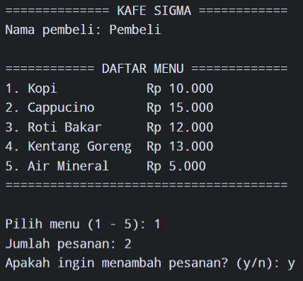
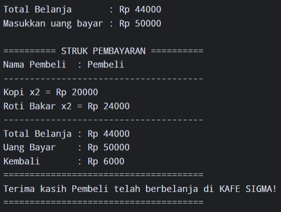

### :coffee: PROGRAM KASIR KAFE

---
**Aplikasi kasir kafe sederhana** berbasis Command Line Interface (CLI) yang dibuat menggunakan bahasa pemrograman C++. Program ini mensimulasikan sistem pemesanan makanan dan minuman di kafe, mulai dari input nama pembeli, pemilihan menu secara berulang, perhitungan total belanja, hingga pencetakan struk pembayaran.

---
#### :gear: Cara Menjalankan Program
Pastikan komputer Anda sudah terinstal compiler C++ seperti **GCC/G++** (MinGW untuk Windows) atau **Clang** (macOS/Linux). Untuk menjalankan program ini, silakan ikuti panduan berikut ini:

1. **Unduh kode program:**
```bash
git clone https://github.com/ardipuji/program-kafe-cpp.git
```

2. **Masuk ke folder proyek:**
```bash
cd program-kafe-cpp
```

3. **Compile kode program:**
```bash
g++ kode_kafe.cpp -o kode_kafe
```

4. **Jalankan program:**
* **Windows (CMD / PowerShell):**
  ```cmd
  kode_kafe.exe
  ```
* **Linux / macOS:**
  ```bash
  ./kode_kafe
  ```

---
#### :camera_flash: Preview
Berikut ini beberapa tampilan Program Kasir Kafe yang berjalan di CLI.

1. **Tampilan Menu & Input Pesanan**



2. **Tampilan Struk Pembayaran**



---
#### :man_technologist: Author

Dikembangkan oleh **Ardi**

- :email: **Email:** [hardipuji19@email.com](mailto:hardipuji19@email.com)
- :link: **GitHub:** [@ardipuji](https://github.com/ardipuji)

---
*Terbuka untuk saran, masukan, maupun peluang kolaborasi!*